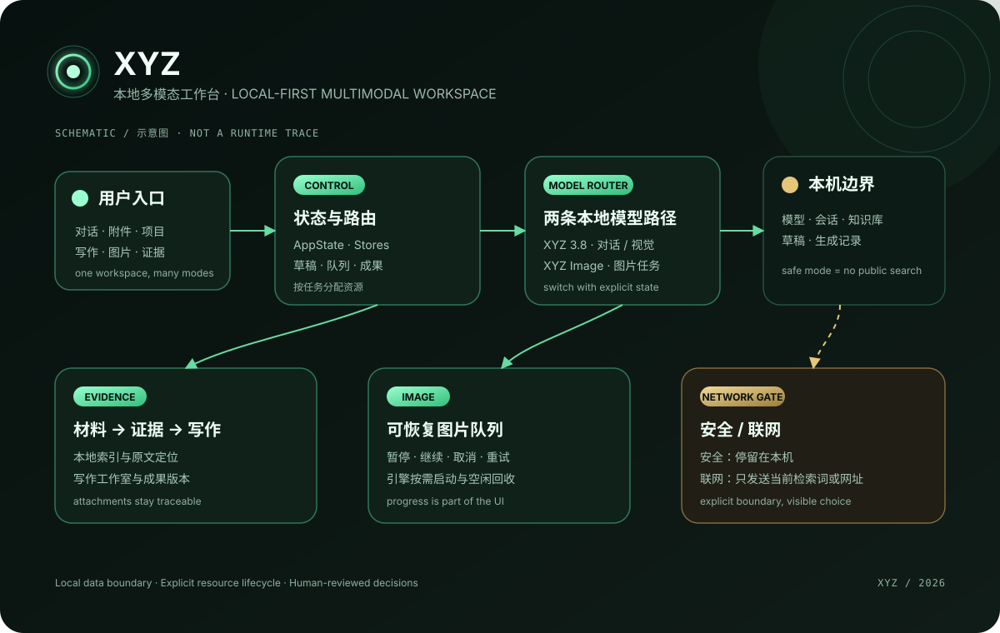
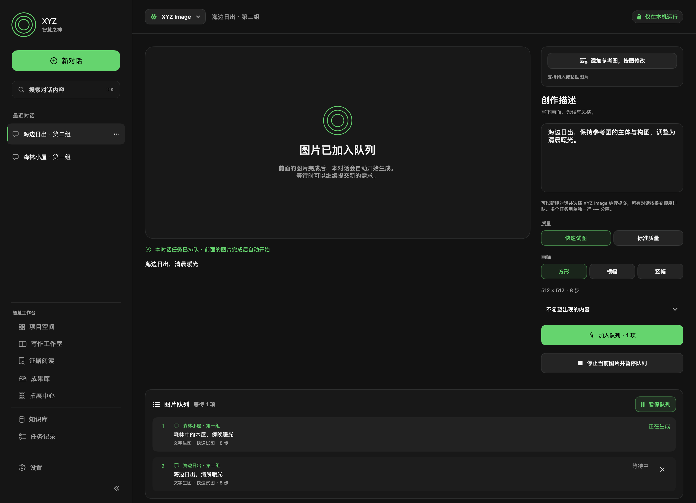

# XYZ

> 本地优先的 macOS 多模态工作台 · A local-first multimodal workspace for macOS.

XYZ is a local-first desktop client for conversation, image understanding, writing, research, and image creation. It keeps everyday work on the Mac, makes network use explicit, and treats model resources, drafts, evidence, and generated images as separate pieces of a recoverable workspace.

这是一个面向个人工作流的本地多模态客户端：用一套原生 macOS 界面连接本地对话、图像理解、写作与研究工具，以及本地图片生成，让输入、模型、证据、草稿和成果之间的关系可见、可恢复、可审查。

上图为原创功能与架构示意图，不是实际运行截图。本仓库提供案例与说明，应用源码保留在私有仓库。

## 它解决什么问题

长对话、参考图、研究材料和写作稿件往往分散在不同工具里。XYZ 把这些工作放进一个本机工作区：用户可以在对话中处理文件，在项目空间里保存长期要求，在知识库和证据阅读中回到原文，在写作工作室里维护版本，并把成果导出为常见文档格式。

## 功能概览

- **本地对话与图像理解**：附件支持图片、PDF、Word、TXT 和 Markdown；文本模型支持 `off / low / medium / xhigh` 四档思考强度。
- **XYZ Image**：从顶部模型菜单进入图片创作；支持提示词、负面提示、画幅与质量设置、参考图、生成记录和可恢复的任务队列。
- **可恢复的交互**：队列可以暂停、继续、取消待执行项和重试失败项；对话草稿、项目、图片记录和成果保存在本机。
- **写作与研究工作区**：项目空间、增量知识库、证据阅读、写作工作室、版本恢复和 Markdown/Word/PDF 导出共同组成长期工作流。
- **明确的网络边界**：安全模式不发起公开网络检索；联网模式只把当前检索词或网址交给公开网络能力。本地附件和历史对话不会因为普通本地工作流自动上传。
- **可控的电脑操作**：打开、定位、创建和移入废纸篓等操作显示明确路径，并在执行前请求确认。

## 交互路线

1. 从顶部模型菜单选择 `XYZ 3.8` 或 `XYZ Image`。
2. 在对话中输入问题、拖入材料，或在图片页提交画面描述与参考图。
3. 用项目空间、知识库和成果库保存长期上下文；需要联网时再显式切换网络模式。
4. 生成图片时查看队列、进度和记录；切回文字工作时释放图片引擎占用的资源。

## 关键设计决定

### 本地优先，但把边界说清楚

对话、草稿、项目、知识库索引、任务记录和生成记录以本机存储为中心。网络功能由单独的安全/联网开关控制，便于用户知道一次操作是否会离开本机。

### 让模型资源服从任务，而不是让任务迁就后台进程

`XYZ 3.8` 和 `XYZ Image` 有各自的资源生命周期。切换模型时释放空闲模型；图片队列空闲后结束专用图片引擎，连续任务则复用已启动的引擎。这样既减少 Metal 内存争用，也让模型状态能够在界面中被解释。

### 保护工作内容的连续性

队列和草稿可在重启后恢复；预览状态与正式工作区隔离；长输入和长回答不会被静默截断；涉及文件的危险操作先展示路径并等待确认。

## 责任与协作方式

本人负责需求定义、交互取舍、数据边界、迭代确认和发布判断。开发过程中使用 AI 辅助实现、测试和文案整理，并结合实际使用反馈检查与改进。

## 边界与当前状态

- 目标平台是 macOS 14 及以上；当前已记录的实际验证环境为 Apple Silicon，其他硬件组合尚未在本项目中完整验证。
- 本地模型文件不随公开展示材料发布；能否运行取决于模型文件完整性、机器资源和系统环境。
- 模型回答可能出错。研究、翻译和事实敏感的写作仍需回到原始材料核验，测试通过不等于每个开放问题都能得到正确答案。
- 本机当前安装检查为 `XYZ 0.18.1 Build 28`（2026-10-03）。本案例描述本地项目的设计与已有验证记录；私有 GitHub 仓库中的应用源码仍是较早快照，不能将两者视为同一版本。

## 深入阅读

真实模型和图片引擎测试需要在私有源项目中另行准备模型与测试素材。现有历史记录与本轮审阅边界见 [验证记录](docs/validation.md)，组件关系见 [架构说明](docs/architecture.md)。公开展示仓库不包含可运行的应用源码或安装包。

## 界面迭代记录

这是 2026-09-22、0.16.1 / Build 19 的隔离测试状态渲染，使用合成对话与任务来呈现跨对话图片排队。它不是私人使用记录，也不是 0.18.1 的当前运行截图。

## English overview

XYZ combines a SwiftUI client with explicit model switching, recoverable image queues, local evidence tools, and a clear network boundary. This repository contains the project case study and original schematic illustrations. Application source and model files remain private.
