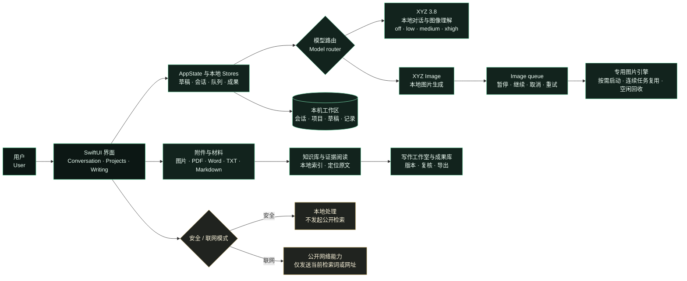

# XYZ 架构说明

> 本图是面向读者的结构示意图，不是运行时调用追踪；具体实现会随源代码快照继续迭代。

## 读图方式

### 界面与状态

界面把输入、模型选择、项目、写作和图片任务交给共享的应用状态层。会话、草稿、队列、项目和成果各自有持久化模型，因而图片任务可以在后台运行，用户仍能浏览历史或切换到另一个对话。

### 两条模型路径

`XYZ 3.8` 负责本地文本对话和图像理解，并提供四档思考强度。`XYZ Image` 走独立的图片任务队列和专用引擎，队列结束或空闲后释放资源。两条路径共享工作区的交互原则，但不强行共用同一套资源生命周期。

### 材料、证据与写作

附件先进入本地材料处理，再按需要进入知识库、证据阅读或写作工作室。证据卡片保留文件、页码或段落等定位信息，写作成果保留版本和来源回链，便于从成稿回到材料。

### 网络边界

安全模式把工作限制在本机；联网模式只为用户主动发起的公开检索或网址阅读提供网络能力。模型、历史对话和本地附件不因为打开普通对话而自动上传。

### 当前边界

模型权重、应用源码和用户资料不属于公开展示材料。图与说明用于解释设计；它们不覆盖所有运行时细节，也不将本机安装版本等同于私有远端源码版本。
